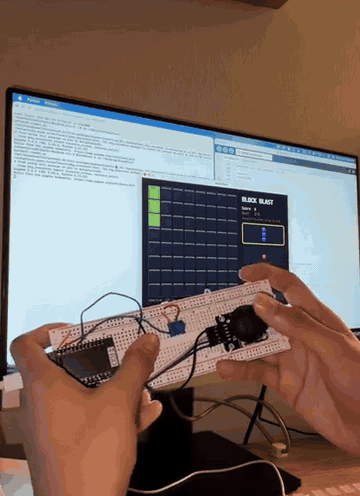
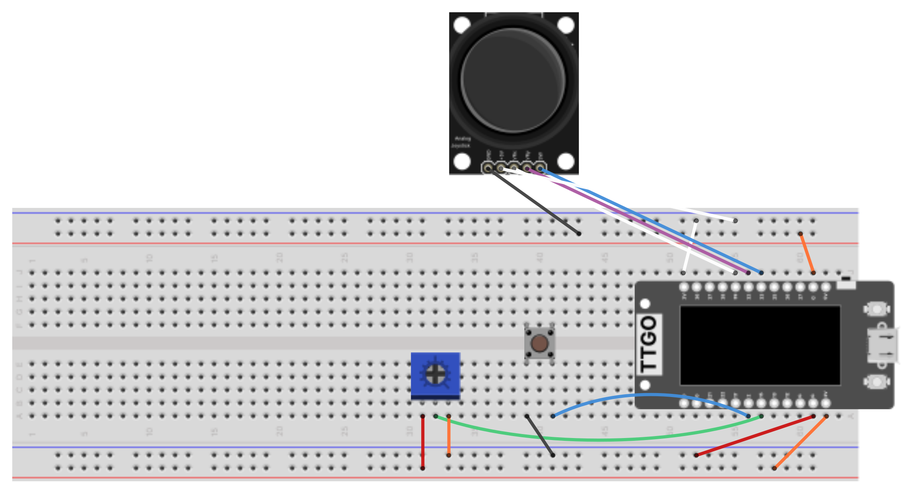

# Block Blast

A handheld Block Blast game: an ESP32 (LILYGO TTGO T-Display) reads a joystick, a potentiometer, and a push button on a breadboard and streams the game state over USB serial to a Pygame viewer on a laptop, which draws the board and plays the music.

Built for Module 2 (Interactive Devices) of Creative Embedded Systems (COMS BC3930), Barnard College, Fall 2026.

**Blog post with the full write-up, design decisions, and videos:** https://ishanimitra-19.github.io/CES-ishanimitra.github.io/module2.html



## What it is

Block Blast is a Tetris-style puzzle: you get three pieces at a time and place them anywhere on an 8x8 grid. Filling a full row or column clears it. The game ends when none of your pieces fit.

Instead of a touchscreen, this version is played with physical controls on a breadboard:

| Control | What it does |
| --- | --- |
| Potentiometer | Chooses which of the three pieces is selected |
| Push button (breadboard) | Confirms the piece and enters placement mode |
| Joystick | Moves the piece around the grid |
| Joystick button (press down) | Drops the piece |

## Hardware

- LILYGO TTGO T-Display (ESP32)
- KY-023 analog joystick module
- 10k potentiometer (trimmer)
- Tactile push button
- Full-size breadboard and jumper wires
- USB-C cable to the computer

## Wiring

| Component pin | ESP32 GPIO |
| --- | --- |
| Joystick VRx | 39 |
| Joystick VRy | 32 |
| Joystick SW | 33 |
| Joystick +5V | 3V3 |
| Joystick GND | GND |
| Potentiometer wiper (middle pin) | 15 |
| Potentiometer outer pins | 3V3 and GND |
| Push button, one leg | 2 |
| Push button, other leg | GND |

The joystick module is powered from the ESP32's 3.3 V pin (not 5 V) so its analog outputs stay within the ESP32's ADC range. Both buttons use the ESP32's internal pull-ups, so they just connect the pin to GND when pressed and need no resistor.

### Fritzing diagram



The editable sketch is in [`fritzing/blockblast.fzz`](fritzing/blockblast.fzz) (the TTGO and joystick parts are bundled inside it).

## How it works

`BlockBlast.ino` runs the whole game on the ESP32: it reads the three inputs, keeps the grid, scores, and clears lines. Whenever something changes it calls `sendFrame()`, which prints one line over serial describing the full state, for example:

```
F;33;0;1;0;0;0;0000...0000;3,2,.####.,7;3,3,..#..####,5;2,2,####,1
```

That line is score, mode, selected slot, cursor x, cursor y, game-over flag, the 64 grid cells, and the three pieces.

`viewer.py` opens the serial port, parses each line, redraws the board in a Pygame window, and plays the music. The ESP32 never needs to know anything about the display, and the viewer never needs to know the game rules.

## How to run

### 1. Flash the ESP32

1. Install the [Arduino IDE](https://www.arduino.cc/en/software) and add the ESP32 board package (Boards Manager, search "esp32" by Espressif).
2. Open `BlockBlast.ino`.
3. Select the board **ESP32 Dev Module** (or **TTGO LoRa32-OLED / T-Display**) and your USB port.
4. Upload.

### 2. Run the viewer

```
pip3 install pygame pyserial numpy
python3 viewer.py
```

The viewer auto-detects the ESP32's serial port. If it picks the wrong one, pass it explicitly, e.g. `python3 viewer.py /dev/cu.usbserial-XXXX`.

Close the Arduino Serial Monitor first, since only one program can own the port at a time. Press **M** in the viewer to mute or unmute the music.

### 3. Play

1. Turn the potentiometer to highlight one of the three pieces.
2. Press the breadboard button to pick it up.
3. Move it with the joystick.
4. Press the joystick down to drop it (or press the breadboard button again to cancel and pick a different piece).
5. After a game over, press the breadboard button to start a new game.

## Files

```
BlockBlast.ino                   ESP32 game logic and serial output
viewer.py                        Pygame viewer (reads serial, draws the board, plays music)
fritzing/blockblast.fzz          Fritzing sketch
fritzing/blockblast_breadboard.png  Breadboard diagram exported from Fritzing
media/blockblast_demo.gif        Gameplay demo
```

## AI use

The game code was generated with Claude (Fable 5.1) from a prompt describing the hardware and the desired controls, then iterated on to fix bugs and change the music. See the [blog post](https://ishanimitra-19.github.io/CES-ishanimitra.github.io/module2.html) for the exact prompt.
